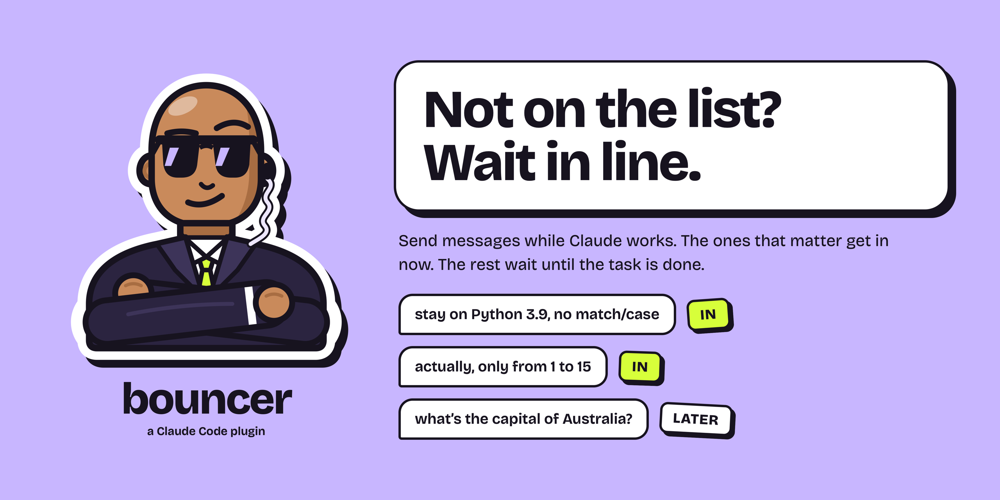
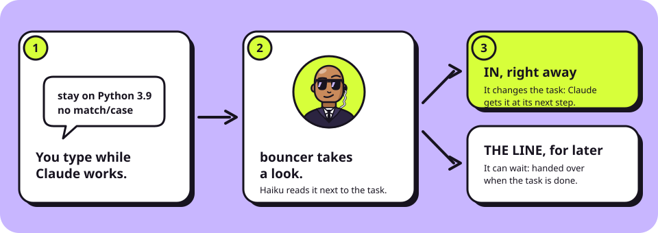

<p align="center">
  
</p>

<p align="center">
  
</p>

<p align="center">
  <b>You hand Claude a long task. Two minutes in, a thought hits you.</b><br>
  Send it now and you might knock the work off course. Keep it for later and you’ll forget it.<br>
  <b>bouncer</b> stands at the door: what matters gets in now, the rest waits in line until the task is done.
</p>

<p align="center">
  
</p>

## Who gets in

<table>
  <tr>
    <td align="center" valign="top" width="33%">
      <br>
      <b>Needed now: gets in</b><br>
      <sub>A correction, a constraint, “stop”, an answer to Claude’s question. Claude gets it at its next step.</sub><br><br>
      <code>stay on Python 3.9, no match/case</code><br>
      <sub>⚡ Let through now.</sub>
    </td>
    <td align="center" valign="top" width="33%">
      <br>
      <b>Can wait: held</b><br>
      <sub>A new task, an unrelated question. It waits outside instead of interrupting.</sub><br><br>
      <code>what’s the capital of Australia?</code><br>
      <sub>⏸ Held until the task is done.</sub>
    </td>
    <td align="center" valign="top" width="33%">
      <br>
      <b>Task done: handed over</b><br>
      <sub>Before Claude stops, bouncer hands it the held messages, and Claude takes care of them.</sub><br><br>
      <code>▶ handing over 1 held message</code><br>
      <sub>“Canberra. And the refactor is done.”</sub>
    </td>
  </tr>
  <tr>
    <td align="center" valign="top" width="33%">
      <br>
      <b>Changed your mind? Send it again</b><br>
      <sub>A held message sent a second time gets straight in.</sub><br><br>
      <code>what’s the capital of Australia?</code> ×2<br>
      <sub>⚡ Let through now: you sent it twice.</sub>
    </td>
    <td align="center" valign="top" width="33%">
      <br>
      <b>Something broke: it gets in anyway</b><br>
      <sub>If the triage fails, your message goes through as usual, and you are told once.</sub><br><br>
      <code>⚠ bouncer could not triage this message</code><br>
      <sub>It went through as usual.</sub>
    </td>
    <td align="center" valign="top" width="33%">
      <br>
      <b>Claude isn’t working: off duty</b><br>
      <sub>Messages sent between tasks are left alone.</sub><br><br>
      <code>thanks! now add tests</code><br>
      <sub>A normal message, no triage.</sub>
    </td>
  </tr>
</table>

## How it decides

<p align="center">
  
</p>

- **In, right away** if it changes the work in progress: a correction, a constraint, a detail, an answer to Claude, a request to stop or change course. A short note goes with it only when the link to the task is not obvious.
- **The line** if it can wait for the end: a separate task, an unrelated question, an idea for later.
- **In, when in doubt.** An ambiguous message gets in, with a note that lists the possible readings instead of picking one.
- **Off duty** when Claude isn’t working: your message is just a message.

## Install

**1 · Add the plugin.** In Claude Code:

```
/plugin install bouncer --marketplace simonvoltalis/bouncer
```

<details>
<summary>Claude Code older than 2.1.275</summary>

```
/plugin marketplace add simonvoltalis/bouncer
/plugin install bouncer@bouncer
```
</details>

**2 · Keep working.** There is nothing to set up. Send messages while Claude works, and watch for ⚡ (let through) and ⏸ (held).

Works in the terminal, in VS Code and in the desktop app. You need Claude Code, signed in (tested with 2.1.331), and Python 3.9 or later on your PATH (`python3`, or `python` on Windows).

## Settings

| Setting | Default | Effect |
| --- | --- | --- |
| `MODEL` | `haiku` | The model that triages messages. |
| `TIMEOUT` | `12` seconds | Past this, the triage gives up and the message gets in. |
| `NOTE_MAX` | `300` characters | The longest note added for Claude. |
| `KEEP_DAYS` | `7` days | Held messages of abandoned sessions are deleted after this. |

For now they are constants at the top of `hooks/bouncer.py`. Turn the plugin off with `claude plugin disable bouncer@bouncer`.

## Behind the door

- **Your words, untouched.** Claude always receives your original message. bouncer can only add a note next to it, capped at 300 characters and marked as an automatic suggestion that your own words override.
- **Never loses a message.** A held message is handed over when the task ends. If the task is interrupted first, it is added to your next message.
- **Fails open.** Error, timeout or doubt: your message gets in as if bouncer weren’t there. The first failure of a session is shown, so a broken setup never goes unnoticed.
- **Sends the minimum.** Only messages sent mid-task are triaged, by Claude Haiku through your own Claude Code account. With them goes a short extract of the recent work: your messages, Claude’s messages, and the names of the tools Claude used with a file path or a description. Never full commands, file contents or tool results. Nothing goes anywhere else.
- **Writes the minimum.** One small state file per session, holding held messages in clear text until they are handed over (abandoned sessions are cleaned up after 7 days), and a log of decisions with no message content: `~/.claude/plugins/data/bouncer-bouncer/log.txt`.
- **Light.** With nothing to sort, each hook takes about 60 ms. A triage is one small Haiku request of 4 to 8 seconds, counted in your usage.
- **Stays out of subagents.** Their messages and stops are left alone.

## Known limits

- Claude Code only hands a mid-task message over between two of Claude’s actions. During a long command, your message waits.
- When held messages are handed over, Claude Code may show a “stop hook” notice. That is expected: it is how bouncer keeps Claude going.
- To know whether Claude is working, bouncer reads Claude Code’s session transcript, whose format is not a public API. If bouncer misbehaves after a Claude Code update, turn it off.
- Used for real on macOS. Linux and Windows are covered by the automated checks, not by real use yet.
- Haiku sometimes adds a note to a message that was clear enough on its own.

<details>
<summary><b>What’s in the repository</b></summary>

```
hooks/           bouncer.py (the whole plugin) and hooks.json
tests/check.py   logic checks against fake events, no model call (--live: three real triages)
assets/          banner, mascot, README visuals and the maker's stamp
  mascot.py      draws the mascot in every pose
  readme.py      builds stickers.svg, flow.svg and the animated demo.svg, fonts embedded
  fonts/         Bricolage Grotesque and JetBrains Mono, with their OFL licenses
.claude-plugin/  plugin and marketplace manifests, icon
.github/         checks on Linux, macOS and Windows on every push
```

</details>

## Tests

```bash
python3 tests/check.py            # logic, no model call
python3 tests/check.py --live     # plus three real triages by Haiku
python3 assets/mascot.py assets   # redraws the mascot
python3 assets/readme.py          # rebuilds the README visuals
```

## Credits

- **Bricolage Grotesque** © The Bricolage Grotesque Project Authors · **JetBrains Mono** © The JetBrains Mono Project Authors. Both under the [SIL Open Font License 1.1](https://openfontlicense.org), embedded in this README’s visuals; the license texts are in `assets/fonts/`.
- The mascot is drawn in code (`assets/mascot.py`), with no image generator.

<br>

<p align="center">
  <br>
  <sub>Code and drawings made with the help of Claude (AI).</sub>
</p>
